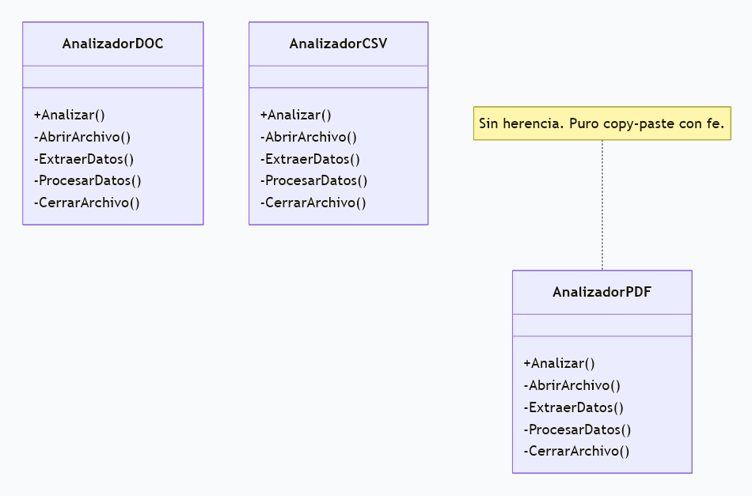
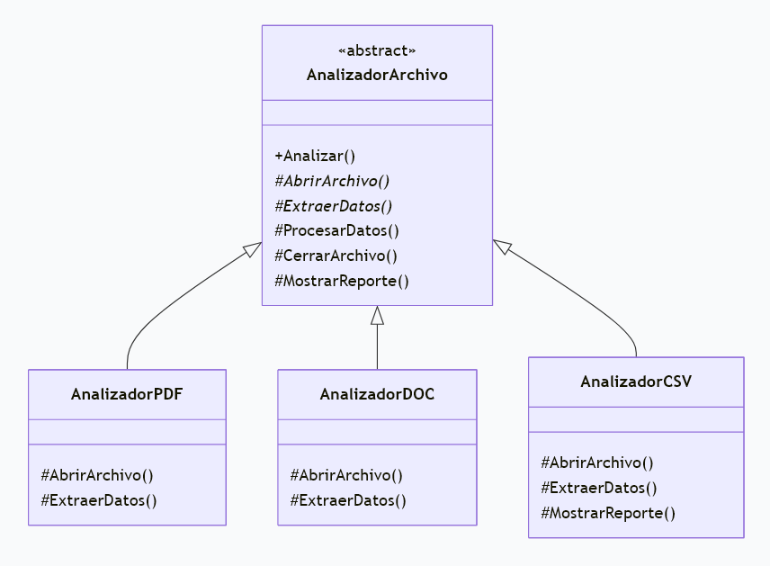
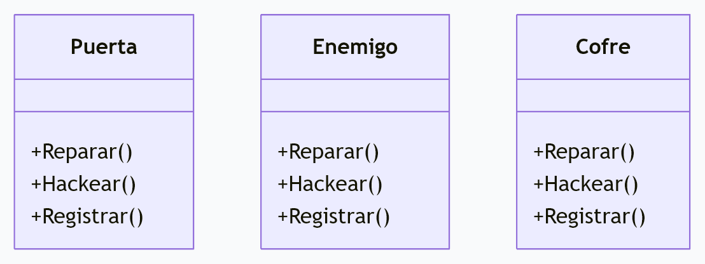
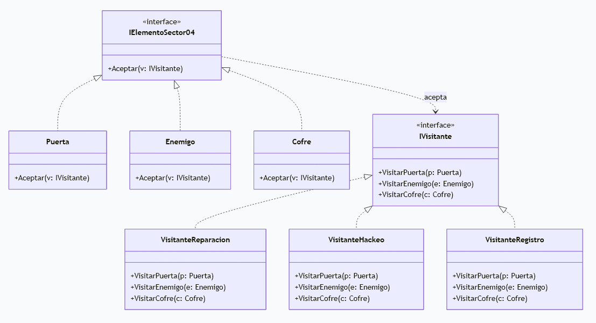

<!-- AndresSTw - Diciconario-Dev -->

[Diccionario-Dev](https://github.com/AndresStw/Diccionario-Dev)

# Patrones de Comportamiento

## Índice

- [Template Method](#template-method)
  - [Definición rápida](#definición-rápida)
  - [Código sin Template Method](#código-sin-template-method)
  - [Código con Template Method](#código-con-template-method)
- [Visitor](#visitor)
  - [Definición rápida](#definición-rápida-1)
  - [Código sin Visitor](#código-sin-visitor)
  - [Código con Visitor](#código-con-visitor)
- [Tecnologías relacionadas](#tecnologías-relacionadas)
- [Sección de preguntas](#sección-de-preguntas-para-clase)

---

## Template Method

> **Definición rápida:** Template Method es un patrón de diseño de comportamiento en el que definimos el esqueleto de un algoritmo en la superclase, pero permitimos que las subclases sobrescriban determinados pasos sin modificar la estructura general.
>
> **Ejemplo:** estamos creando una aplicación de minería de datos donde analizamos documentos PDF, DOC y CSV.

### Código sin Template Method

Tres clases, tres veces el mismo protocolo.

```csharp
// AnalizadorPDF
public class AnalizadorPDF
{
    public void Analizar()
    {
        AbrirArchivo();       // <-- copia
        ExtraerDatos();       // <-- copia (aunque el contenido cambia)
        ProcesarDatos();      // <-- copia
        CerrarArchivo();      // <-- copia
    }

    private void AbrirArchivo()  => Console.WriteLine("Abriendo PDF...");
    private void ExtraerDatos()  => Console.WriteLine("Extrayendo texto del PDF");
    private void ProcesarDatos() => Console.WriteLine("Procesando datos comunes");
    private void CerrarArchivo() => Console.WriteLine("Cerrando PDF...");
}

// AnalizadorDOC
public class AnalizadorDOC
{
    public void Analizar()
    {
        AbrirArchivo();       // <-- copia
        ExtraerDatos();       // <-- copia
        ProcesarDatos();      // <-- copia
        CerrarArchivo();      // <-- copia
    }

    private void AbrirArchivo()  => Console.WriteLine("Abriendo DOC...");
    private void ExtraerDatos()  => Console.WriteLine("Extrayendo texto del DOC");
    private void ProcesarDatos() => Console.WriteLine("Procesando datos comunes");
    private void CerrarArchivo() => Console.WriteLine("Cerrando DOC...");
}

// AnalizadorCSV
public class AnalizadorCSV
{
    public void Analizar()
    {
        AbrirArchivo();       // <-- copia
        ExtraerDatos();       // <-- copia
        ProcesarDatos();      // <-- copia
        CerrarArchivo();      // <-- copia
    }

    private void AbrirArchivo()  => Console.WriteLine("Abriendo CSV...");
    private void ExtraerDatos()  => Console.WriteLine("Extrayendo filas del CSV");
    private void ProcesarDatos() => Console.WriteLine("Procesando datos comunes");
    private void CerrarArchivo() => Console.WriteLine("Cerrando CSV...");
}
```

**Diagrama:**



### Código con Template Method

```csharp
// Superclase: define el esqueleto del algoritmo
public abstract class AnalizadorArchivo
{
    // Método principal: establece el orden de los pasos
    public void Analizar()
    {
        AbrirArchivo();       // Paso variable: lo define la subclase
        ExtraerDatos();       // Paso variable: lo define la subclase
        ProcesarDatos();      // Paso común: vive una sola vez
        CerrarArchivo();      // Paso común: vive una sola vez
        MostrarReporte();     // Hook opcional: punto de extensión
    }

    // Pasos que deben cambiar según el formato del archivo
    protected abstract void AbrirArchivo();
    protected abstract void ExtraerDatos();

    // Pasos comunes: se escriben una vez y se heredan
    protected virtual void ProcesarDatos()
        => Console.WriteLine("Procesando datos comunes (auditoría Sector 04)");

    protected virtual void CerrarArchivo()
        => Console.WriteLine("Cerrando archivo con protocolo de seguridad");

    // Hook: tiene una implementación por defecto que puede sobrescribirse
    protected virtual void MostrarReporte()
        => Console.WriteLine("Reporte estándar listo.");
}

// Subclases: implementan los pasos específicos de cada formato
public class AnalizadorPDF : AnalizadorArchivo
{
    protected override void AbrirArchivo()
        => Console.WriteLine("Abriendo PDF...");

    protected override void ExtraerDatos()
        => Console.WriteLine("Extrayendo texto del PDF");
}

public class AnalizadorDOC : AnalizadorArchivo
{
    protected override void AbrirArchivo()
        => Console.WriteLine("Abriendo DOC...");

    protected override void ExtraerDatos()
        => Console.WriteLine("Extrayendo texto del DOC");
}

public class AnalizadorCSV : AnalizadorArchivo
{
    protected override void AbrirArchivo()
        => Console.WriteLine("Abriendo CSV...");

    protected override void ExtraerDatos()
        => Console.WriteLine("Extrayendo filas del CSV");
}
```

**Diagrama:**



---

## Visitor

> **Definición rápida:** Visitor es un patrón de diseño de comportamiento que separa las operaciones de los objetos sobre los que operan, permitiendo añadir nuevas operaciones sin modificar las clases de los elementos.
>
> **Ejemplo:** estamos creando Sector 04, donde tenemos elementos como Puerta, Enemigo y Cofre, y queremos realizar operaciones como Reparar, Hackear y Registrar.

### Código sin Visitor

Tres clases, cada una cargando operaciones que no le corresponden.

```csharp
// Puerta
public class Puerta
{
    public void Reparar()
        => Console.WriteLine("Reparando puerta del Sector 04");

    public void Hackear()
        => Console.WriteLine("Hackeando puerta... espera, ¿la puerta tiene firewall?");

    public void Registrar()
        => Console.WriteLine("Registrando puerta en auditoría");
}

// Enemigo
public class Enemigo
{
    public void Reparar()
        => Console.WriteLine("Reparando enemigo... no preguntes"); // <-- copia (y raro)

    public void Hackear()
        => Console.WriteLine("Hackeando enemigo (ahora es MI enemigo)"); // <-- copia

    public void Registrar()
        => Console.WriteLine("Registrando enemigo en auditoría"); // <-- copia
}

// Cofre
public class Cofre
{
    public void Reparar()
        => Console.WriteLine("Reparando cofre"); // <-- copia

    public void Hackear()
        => Console.WriteLine("Hackeando cofre... un cofre que hackea, bienvenidos al Sector 04"); // <-- copia

    public void Registrar()
        => Console.WriteLine("Registrando cofre en auditoría"); // <-- copia
}
```

**Diagrama:**



---

### Código con Visitor

Las clases quedan independientes: los elementos solo aceptan, los visitantes ejecutan las operaciones.

```csharp
public interface IElementoSector04
{
    void Aceptar(IVisitante visitante); // "Pasa, solo el especialista"
}

public class Puerta : IElementoSector04
{
    public void Aceptar(IVisitante visitante)
        => visitante.VisitarPuerta(this);
}

public class Enemigo : IElementoSector04
{
    public void Aceptar(IVisitante visitante)
        => visitante.VisitarEnemigo(this);
}

public class Cofre : IElementoSector04
{
    public void Aceptar(IVisitante visitante)
        => visitante.VisitarCofre(this);
}

public interface IVisitante
{
    void VisitarPuerta(Puerta puerta);
    void VisitarEnemigo(Enemigo enemigo);
    void VisitarCofre(Cofre cofre);
}

public class VisitanteReparacion : IVisitante
{
    public void VisitarPuerta(Puerta p)
        => Console.WriteLine("Reparando puerta del Sector 04");

    public void VisitarEnemigo(Enemigo e)
        => Console.WriteLine("Reparando enemigo... no preguntes");

    public void VisitarCofre(Cofre c)
        => Console.WriteLine("Reparando cofre");
}

public class VisitanteHackeo : IVisitante
{
    public void VisitarPuerta(Puerta p)
        => Console.WriteLine("Hackeando puerta... ¿la puerta tiene firewall?");

    public void VisitarEnemigo(Enemigo e)
        => Console.WriteLine("Hackeando enemigo (ahora es MI enemigo)");

    public void VisitarCofre(Cofre c)
        => Console.WriteLine("Hackeando cofre... un cofre que hackea, bienvenidos al Sector 04");
}

public class VisitanteRegistro : IVisitante
{
    public void VisitarPuerta(Puerta p)
        => Console.WriteLine("Registrando puerta en auditoría");

    public void VisitarEnemigo(Enemigo e)
        => Console.WriteLine("Registrando enemigo en auditoría");

    public void VisitarCofre(Cofre c)
        => Console.WriteLine("Registrando cofre en auditoría");
}
```

**Diagrama:**



---

## Tecnologías relacionadas

- **C#:** lenguaje de programación utilizado para implementar los patrones de diseño mediante clases, interfaces, herencia y métodos.
- **Programación orientada a objetos (POO):** forma de programar utilizando clases y objetos. Es la base para entender cómo funcionan estos patrones.
- **UML (diagramas de clases):** permite representar visualmente las clases, las interfaces y las relaciones entre ellas para comprender mejor cómo está organizado el código.
- **.NET:** plataforma que permite ejecutar aplicaciones desarrolladas en C#.
- **Principios SOLID:** conjunto de principios que ayudan a escribir código más organizado, flexible y fácil de mantener. Se relacionan con el objetivo de muchos patrones de diseño.

### ¿Cómo se relacionan con los patrones?

- **Template Method:** utiliza principalmente herencia y métodos para definir una estructura común y permitir que las subclases implementen pasos específicos.
- **Visitor:** utiliza interfaces, clases y métodos para separar las operaciones de los objetos sobre los que se realizan.

> [!summary]
>
> ## Sección de preguntas para clase
>
> **1. ¿Qué significa `void`?**
>
> - A) Que devuelve un número entero.
> - B) Que el método no devuelve un valor.
> - C) Que solo acceden las clases hijas.
>
> **2. ¿Qué palabra permite sobrescribir un método heredado?**
>
> - A) `override`
> - B) `private`
> - C) `return`
>
> **3. ¿Qué diferencia hay entre `virtual` y `abstract`?**
>
> - A) Son exactamente iguales.
> - B) `virtual` tiene una implementación inicial; `abstract` no.
> - C) `abstract` siempre devuelve un valor.
>
> **4. ¿Para qué sirve `protected`?**
>
> - A) Solo para la propia clase.
> - B) Para la propia clase y sus clases derivadas.
> - C) Para cualquier clase sin restricciones.
>
> **5. ¿Qué define una interfaz?**
>
> - A) Un contrato que una clase puede implementar.
> - B) Una clase que siempre se puede instanciar.
> - C) Un método que devuelve texto.
